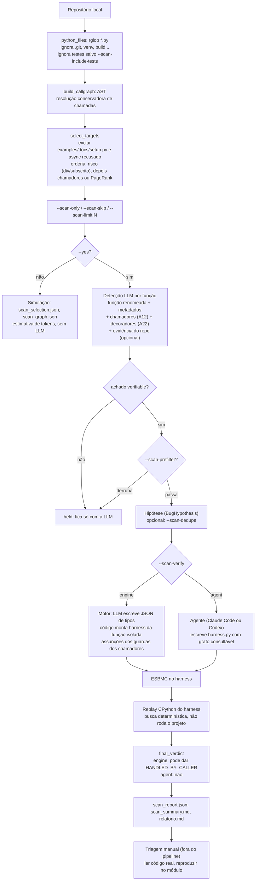

# Auditoria 3: modo scan e análise de repositórios reais (16/11/2026)

Documento de trabalho da Fernanda. Complementa `auditoria_pipeline_2026-11-16.md`, `auditoria_0_inventario_2026-11-16.md` e `auditoria_1_bugsinpy_2026-11-16.md`.

**Como foi feito.** Claude Code (Opus 5.5), só leitura. Li o código do scan (`src/research_pipeline/scan/*.py`, `src/main.py` em `mode_scan`, `src/research_pipeline/cli.py`, `verify/agent_scan.py`, partes de `verify/loop.py`, `verify/outcome.py`, `verify/caller_facts.py`, `verify/agent_arm.py`, `llm/prompts.py`, `llm/prompt_variants.py`, `scripts/scan_noite.sh`). Os `scan_report.json`, `scan_checkpoint.json` e `scan_selection.json` foram lidos com Python que só imprime (scripts no scratchpad da sessão). Nada foi executado contra LLM, ESBMC ou rede. Não abri as páginas do GitHub (issues #132, #3085, PR #189).

**Rótulos:** [F] fato verificado no código ou no artefato bruto; [F-doc] está escrito num documento do repositório, não conferido no bruto; [I] inferência; [H] hipótese; [NV] não verificado.

---

## 1. Resumo em dez pontos

1. **[F]** O scan percorre o repositório inteiro pela AST, monta um grafo de chamadas conservador e escolhe as N primeiras funções de um ranking. Nas rodadas reais, N ficou entre 5 e 40 (15 na maioria). Em repositórios grandes, isso cobre menos de 1% das funções elegíveis (botocore: 15 de 1.980).
2. **[F]** O ranking põe primeiro as funções com divisão ou subscrito (`pipeline.py:145-150`). Isso explica por que 22 dos 35 `CONFIRMED` brutos são `KeyError`.
3. **[F]** A LLM recebe só a função (renomeada para `target_function`, sem docstring), metadados e, com A12, até 8 trechos de chamadores com no máximo 3.000 caracteres (`context.py:10-11`). Não recebe o arquivo inteiro, os chamados nem a documentação, salvo com `--scan-repository-context evidence`.
4. **[F]** A verificação é a mesma da V2: harness de uma função isolada, entradas não determinísticas, atributos gerados, ESBMC e replay no CPython **do harness**. O projeto real nunca é executado pelo pipeline.
5. **[F]** Não há prova de alcançabilidade interprocedural. O que existe: guardas de chamadores viram assunções, e `HANDLED_BY_CALLER` quando **todos** os chamadores diretos capturam a exceção. Isso só vale no motor (`engine`); o braço de agente chama `final_verdict` sem esse argumento (`agent_arm.py:535`).
6. **[F]** Somando os relatórios brutos (20 `scan_report.json` finais mais 3 checkpoints sem relatório final), há **35 hipóteses `CONFIRMED`**. Achei triagem manual por caso para 13 delas; nenhuma virou bug novo. Para as outras 22 (todas da Amazon, de 13 e 14/11) não achei triagem caso a caso, só a frase geral "nenhum bug reportável" em `PLANO_CODEX_2026-11-14.md:9` e na memória do projeto.
7. **[F-doc]** O único bug novo veio de leitura da LLM, não do ESBMC: GSA de 17 campos no driver Adafruit GPS (issue #132). O pynmea2 reencontrou um bug já coberto pela PR #189. A issue pymodbus #3085 veio de um `REPRODUCED_CPYTHON` (o ESBMC não decidiu) e foi conferida à mão chamando o módulo real.
8. **[F]** Quase metade das hipóteses verificadas (182 de 370 nos relatórios finais) terminou em `LLM_ONLY`, ou seja, o motor não conseguiu montar ou checar o programa, mesmo após o self-healing.
9. **[F]** O relatório não grava o commit do pipeline nem o commit do repositório analisado. O ESBMC fica registrado (versão e hashes em `config.capabilities.identity`). O perfil `congelado` recusa o modo scan (`main.py:569-572`), então nenhum scan usou a configuração congelada dos 47.
10. **[I]** Para o artigo de CPS (30/11), o scan serve como estudo exploratório de falso positivo em três repositórios ciberfísicos já rodados, sem métrica de precisão ou recall. Ampliar isso exige gasto e triagem que não cabem com folga no prazo.

---

## 2. Fluxograma

---

## 3. Respostas às 15 perguntas

### 3.1 Como percorre o repositório e seleciona funções

- **[F]** `callgraph.py:134-149`: todos os `*.py` por `rglob`, pulando `SKIP_DIRS` (`.git`, `venv`, `build`, `dist`, `site-packages`, `node_modules` e outros, l. 19-20) e, por padrão, caminhos de teste: pasta `test`, `tests` ou `testing`, arquivo `test_*`, `*_test.py`, `conftest.py` (l. 21, 146-149).
- **[F]** Arquivo com erro de sintaxe é pulado e contado em `skipped` (l. 174-182).
- **[F]** Uma função é "verificável" quando não é ambígua e é de módulo, método de classe de módulo ou aninhada (l. 49-53). Classes aninhadas em classes ficam de fora.
- **[F]** `select_targets` (`pipeline.py:177-214`) tira da seleção `examples`, `example`, `samples`, `sample`, `docs`, `doc` (l. 64), o `setup.py` da raiz e coroutines que o ESBMC-Python ou o harness não suportam (l. 153-174). Elas continuam no grafo como chamadores.
- **[F]** A comparação de pasta é por nome exato. Exemplo visto no bruto: `python/test_tools/transcribe_stubber.py` do aws-doc-sdk-examples entrou na seleção e gerou 2 `CONFIRMED` em duas rodadas (`sdk_examples_lote1` e `lote3`), embora seja ferramenta de teste.

### 3.2 Filtros e limites

| Mecanismo | Onde | O que faz | Usado em rodada real? |
|---|---|---|---|
| `--scan-limit N` | `pipeline.py:214` | corta o ranking nas N primeiras | sim, em todas [F] |
| `--scan-skip N` | `pipeline.py:213` | pula as N primeiras (próximo lote) | só como padrão 0 nos `scan_noite.sh` [F] |
| `--scan-only` | `pipeline.py:208-212` | só funções nomeadas, guardando a posição no ranking | só no piloto do bug semeado (31/10) [F] |
| ranking `callers` | `rank_key`, l. 145-150 | risco primeiro, depois nº de chamadores | rodadas até 11/11 [F] |
| ranking `pagerank` | `graph_metrics.py`, `rank_key` | risco primeiro, depois centralidade | a partir de 12/11 e na CLI `llm-esbmc scan` (`cli.py:50`) [F] |
| `--scan-prefilter` | `prefilter.py:187-208` | derruba hipótese que diz faltar nome ou método que o código define, ou que admite depender de código não mostrado (regex) | lote2 e lote3 com Sonnet, 13 e 14/11 [F] |
| `--scan-context-retry` | `context_retry.py` | refaz a detecção com até 3 definições de 4.000 caracteres | **nunca** em rodada real [F: nenhuma `scan_selection.json` tem a chave] |
| `--scan-dedupe` | `dedupe.py` | agrupa hipóteses de funções com AST idêntica | **nunca** em rodada real [F] |
| triagem da LLM | `_detect`, l. 375-377 | achado `verifiable: false` vai para `held` | sempre [F] |

- **[F]** A regra "risco primeiro" significa que funções sem divisão nem subscrito só entram depois de todas as que têm. Isso molda o tipo de bug encontrado.
- **[F]** A estimativa de tokens da simulação fica muito abaixo do medido. Exemplo: botocore lote2 estimou 62.349 tokens de detecção (`scan_selection.json`) e registrou 912.664 (`scan_report.json`). Em GPS, 151.435 estimados e 3.267.781 medidos. **[H]** A diferença vem do contexto que o `claude -p` acrescenta, o mesmo ponto 10 da auditoria do pipeline.

### 3.3 O que vai ao LLM

- **[F] Detecção** (`prompts.py:116-143`): a função sem docstring e renomeada para `target_function` (`_source_for_llm`, l. 166), metadados (linhas, parâmetros, type hints), e as seções das variantes ativas. As rodadas usaram `A1,A2,A12` (até 12/11) ou `A1,A2,A12,A22` (a partir de 13/11, `scan_noite.sh`).
- **[F]** A1 manda a LLM **reportar mesmo quando falta contexto** e deixar ESBMC e replay decidirem (`prompt_variants.py:17-22`). O prefiltro depois derruba parte dessas hipóteses pela frase "context needed". As duas peças puxam em sentidos opostos.
- **[F]** O `--scan-focus` entra como texto livre (`main.py:589`, `set_detection_focus`). Não vi uso dele nos relatórios conferidos.
- **[F] Especificação do harness (motor)**: com `--spec-context callers` (padrão, `cli_args.py:274-280`), a LLM vê chamadas e "fatos de uso" lidos da AST (`caller_facts.py:1-4`) e, quando ligado, o bloco de evidência do repositório (`loop.py:230-240`).
- **[F] Agente**: recebe a hipótese, o grafo consultável e trechos de documentação ou a evidência do repositório (`agent_scan.py:52-60`).

### 3.4 AST, chamadores, fluxo de dados e contexto do projeto

- **[F] Grafo de chamadas**: só AST, resolução conservadora (`callgraph.py:1-7`): mesmo módulo, imports do repositório, `self`, `cls`, `super()`, `Classe(...)`, variável local ligada só a `Classe(...)`. O resto é "externo". No botocore, 2.478 de 7.195 chamadas foram resolvidas (`run.log`).
- **[F] Chamadores**: `caller_context` mostra até 8 sítios, 3 linhas antes e 1 depois, sem invadir outra função (`context.py:14-68`). `--scan-caller-depth 2` sobe um nível. Todas as rodadas usaram profundidade 1 [F: `config.caller_depth`].
- **[F] Fluxo de dados**: não há análise de fluxo. O que existe são "guardas" sintáticas dos chamadores que valem em todos os sítios (`caller_guards`, `caller_facts.py:302`) e o tipo inferido pelo uso dentro da função.
- **[F] Contexto do projeto** (`repository_context.py`): README, `template*.yaml/json`, `doc/`, `docs/`, `events/*.json`, com limites (l. 14-19). Traz um texto fixo sobre o evento do API Gateway (l. 28-35), escrito depois do falso positivo do sam-python-crud-sample. O próprio texto diz que nenhuma restrição é adicionada automaticamente. **[F]** Só foi usado nas duas rodadas Codex de 12/11 (rotation e glue), que tiveram falhas de infraestrutura.

### 3.5 Construção dos harnesses

- **[F]** Motor: o mesmo da V2 e dos 47. A LLM devolve só JSON (`params`, `attributes`, `stubs`, `assumptions`); o código renderiza o programa, corta depois da suspeita, troca imports por stubs, gera atributos do `self` (`loop.py:242-293`, auditoria do pipeline Parte 3, itens 4 e 5).
- **[F]** Agente: o próprio agente escreve `harness.py`. No GPS, o harness de `_parse_float` é a função copiada mais `field: str = nondet_str(); _parse_float(field)` (`artifacts/cps/gps/agent_cases/d0a5174fe86f/harness.py`). Não há chamador real no programa.

### 3.6 Função isolada ou caminhos amplos?

- **[F]** Função isolada. O harness do motor tem um módulo só (a própria mensagem de exclusão diz isso, `pipeline.py:288-290`). O ESBMC não vê o chamador, salvo se a LLM ou o agente o copiarem. Caminhos a partir da entrada pública do projeto não são construídos.

### 3.7 Stubs e pré-condições: do projeto ou inferidos?

- **[F] Do projeto, lidos da AST**: guardas comuns a todos os chamadores (viram `__ESBMC_assume`, `loop.py:257-260`), tipos contrariados pelo uso (rejeitam a especificação), chaves de dicionário atribuídas no código (só listadas no relatório, "não comprovam que foram executadas", `pipeline.py:570-575`).
- **[F] Inferidos pela LLM**: tipos dos parâmetros, atributos, stubs de bibliotecas e assunções. A validação das assunções é sintática (auditoria do pipeline, Parte 3, item 4).
- **[F]** O contexto do repositório é mostrado como evidência, nunca convertido em pré-condição (`repository_context.py:1`, `AWS_CONTRACT`).

### 3.8 O replay executa o harness ou o programa original?

- **[F]** O harness. O replay roda o programa gerado (ou sua cópia com o corpo original, quando o healing simplificou o corpo, `loop.py:141-153`), com busca determinística (`replay_worker.py:285-330`, já visto na auditoria do pipeline). O resumo do scan diz isso ao leitor: "O replay executa o programa gerado. Ele não demonstra, sozinho, que o estado usado seja um estado alcançável no projeto" (`pipeline.py:555-556`).
- **[F-doc]** As reproduções no módulo real (pymodbus `Log.build_msg`, pyserial `iterbytes`, `pack_bitstring`) foram feitas à mão, fora do pipeline, com o comando registrado em `docs/pgene601/artigo/tabela_scans.md`.

### 3.9 Evidência de alcançabilidade no contexto real

- **[F]** Não há. Os três mecanismos que se aproximam:
  1. `HANDLED_BY_CALLER` (`outcome.py:126-137`), criado em 12/11 (commit `2343fbf`): só chamadores diretos, só `try` que envolve a chamada, e só se **todos** os sítios capturam. Apareceu 2 vezes no bruto (aws-doc-sdk-examples lote2).
  2. Guardas dos chamadores como assunções.
  3. No agente, `NOT_CONFIRMED_VACUOUS` testa se o harness chega à linha (`agent_arm.py:541-552`). Isso é alcance **no harness**, não no projeto.
- **[F]** O `scan_summary.md` intitula os `CONFIRMED` como "Confirmados isolados: ESBMC e replay (o alcance no projeto ainda não foi verificado)" (`pipeline.py:547`). O campo `verdict` do JSON continua `CONFIRMED`.

### 3.10 Mesmos critérios de CONFIRMED dos 47?

| Caminho | Regra | Diferença em relação aos 47 |
|---|---|---|
| Scan com `--scan-verify engine` (Amazon, pyserial) | mesma `final_verdict` | recebe o grafo do repositório, então `HANDLED_BY_CALLER` pode disparar; nos 47 os arquivos só têm as funções rotuladas, logo não há chamador [I a partir da auditoria do pipeline, item 10 da Parte 2] |
| Scan com `--scan-verify agent` (GPS, pynmea2, pymodbus, CLI `llm-esbmc scan`, `/verify-repo`) | `final_verdict(reading, replay)` sem chamadores (`agent_arm.py:535`) mais níveis próprios (`REPRODUCED_CPYTHON`, `AGENT_FAILED`, `NOT_CONFIRMED_VACUOUS`) | regra diferente; o perfil congelado dos 47 usa o motor |

- **[F]** Nenhum scan rodou com o perfil `congelado` (recusado em `main.py:569-572`). Os scans também não têm a mesma versão do código: rodaram entre 08/11 e 14/11, antes do ESBMC e da tag de 16/11.

### 3.11 Repositórios analisados

Ver a seção 6. Resumo **[F]**: 3 ciberfísicos com verificação (Adafruit GPS, pynmea2, pyserial), 1 com verificação parcial descartada (pymodbus), 11 da Amazon (aws-samples e upstream). Sete ciberfísicos só tiveram simulação (`artifacts/cps/*-plan`): bleak, cantools, gpiozero, paho.mqtt.python, pymodbus, python-can, pyvisa. Nenhum desses sete tem checkpoint, portanto **não foram rodados** com LLM.

### 3.12 Logs e resultados brutos

- **[F]** Cada rodada grava `scan_selection.json`, `scan_graph.json`, `scan_checkpoint.json`, `scan_report.json`, `scan_summary.md`, `relatorio.md`, `run.log`, mais `programs/` (motor) ou `agent_cases/` (agente).
- **[F]** Os resultados da Amazon estão em `/mnt/e/scan_amazon/` (fora do repositório, acessível nesta sessão). Os relatórios agregados (`RELATORIO_2026-11-13.md`, `lote2/RELATORIO_2026-11-13.md`, `lote3/RELATORIO_lote3.md`, `lote3/RELATORIO_2026-11-14.md`) são resumos automáticos e avisam: "Nada aqui é achado confirmado".
- **[F]** Artefatos desatualizados ou parciais: `artifacts/scan_aws_codex_2026-11-12/rotation/scan_report.json` diz 40 de 40 detecções com erro, mas o checkpoint tem 39 detecções boas e 26 vereditos (documentado em `indice_scans_2026-11-12.md`). O pymodbus só tem 3 funções no checkpoint atual; os vereditos antigos estão em `scan_verify_discarded_*.json`. O veredito do `Log.build_msg` (issue #3085) **não está** em nenhum JSON de veredito; só em `agent_cases/788a8c17e877/` e no registro `scan_pymodbus_codex_2026-11-10.md`.
- **[F]** As rodadas de 13 e 14/11 (lote2, lote3, Haiku de 13/11) não têm entrada em `docs/experimentos/README.md`. Aparecem só em `REGISTRO_MODELOS_TOKENS.md` (parte delas) e nos planos do Codex.

### 3.13 Bugs novos confirmados e validados

- **[F]** Pelo ESBMC: nenhum bug novo validado no projeto.
- **[F-doc]** Por leitura da LLM, conferido à mão com o driver real: GSA de 17 campos no Adafruit GPS (issue #132, segundo `indice_scans_2026-11-12.md`). O ESBMC não tem especificação para essa fatia errada.
- **[F-doc]** Reencontrado, já conhecido: pynmea2, `IndexError` em `ASHRATT.match` e `TNLDG.match` com sentença truncada (PR #189 do repositório). [NV] a página da PR.
- **[F-doc]** Pymodbus `Log.build_msg('{} {}', 0, '')` levanta `IndexError` no módulo real; issue #3085 aberta pela Fernanda. Saiu de um `REPRODUCED_CPYTHON`, não de um `CONFIRMED`.

### 3.14 Limitações e erros registrados

Ver a seção 8.

### 3.15 Testes automatizados do scan

| Arquivo | Testes | Observação |
|---|---:|---|
| `tests/test_scan_pipeline.py` | 51 | analisador e ESBMC falsos (`_fake_esbmc`, l. 290) |
| `tests/test_scan_repository_context.py` | 20 | |
| `tests/test_scan_graph_metrics.py` | 18 | |
| `tests/test_scan_callgraph.py` | 17 | |
| `tests/test_scan_prefilter.py` | 15 | |
| `tests/test_scan_context.py` | 10 | |
| `tests/test_scan_context_retry.py` | 7 | |
| `tests/test_scan_dedupe.py` | 2 | |
| `tests/test_scan_confirmation_notice.py` | 1 | aviso do `scan_summary.md` |
| `tests/test_verify_agent_scan.py`, `test_caller_exception_context.py`, `test_cli.py`, `test_relatorio_scans.py` | 6, 6, 7, 1 | relacionados |

- **[F]** São 9 arquivos `test_scan_*` (não 10). Contei funções `def test_` com grep; não rodei a suíte. Os testes usam dublês: nenhum chama LLM ou ESBMC real, então não medem a qualidade do achado, só o comportamento do código.

---

## 4. Matriz de contexto disponível

| Informação | 47 (perfil congelado) | BugsInPy (V2) | Scan, motor | Scan, agente |
|---|---|---|---|---|
| Função alvo dada antes | sim, arquivo recortado com 1 ou 2 funções [F, aud. pipeline] | sim, pelo manifesto (arquivo e função) [F-doc, aud. 1] | não, ranking escolhe [F] | não [F] |
| Arquivo inteiro na detecção | não [F] | [NV nesta auditoria] | não (A11 desligada) [F] | não [F] |
| Chamadores na detecção | não [F] | não por padrão [I] | sim, A12, até 8 sítios [F] | sim, A12 [F] |
| Chamadores na especificação | só os do arquivo (nenhum) [I] | só os do arquivo [I] | sim, do grafo do repositório [F] | grafo consultável pelo agente [F] |
| Chamados (callees) | não | não | não (A19 desligada) [F] | via grafo, se o agente consultar [I] |
| Decoradores | não | não | sim a partir de 13/11 (A22) [F] | idem [F] |
| Documentação ou config | não | não | só com `evidence` (rodadas Codex) [F] | trechos de doc ou evidência [F] |
| Captura pelo chamador no veredito | não dispara (sem chamador) [I] | depende do arquivo [I] | sim, `HANDLED_BY_CALLER` [F] | não [F] |
| Gabarito | sim, conserto dos mantenedores [F-doc] | sim, patch do BugsInPy [F-doc] | não | não |

---

## 5. Comparação scan × BugsInPy × 47

| Dimensão | 47 bugs | BugsInPy | Scan |
|---|---|---|---|
| Entrada | 47 arquivos recortados à mão | arquivos da versão com bug | repositório inteiro |
| Localização prévia | nível de função, dada | arquivo e função no manifesto | nenhuma; ranking e corte em N |
| Unidade de análise | função | função | função |
| Verificação | motor, perfil congelado | motor (rodadas da V2) | motor ou agente, sem perfil congelado |
| Avaliação | regra por função contra o conserto | contra o rótulo (função ou linha) | triagem manual, sem gabarito |
| O que dá para medir | acerto por função | acerto por função ou linha | contagem de vereditos e taxa de falso positivo na amostra triada |

**Cinco níveis de evidência, e onde cada fonte chega:**

| Nível | O que significa | 47 | BugsInPy | Scan |
|---|---|---|---|---|
| L1 localização automática | o pipeline aponta a função sem ajuda | não testado (função dada) | não testado | **sim**, só aqui; mas limitado às N primeiras do ranking |
| L2 violação no harness | ESBMC acha violação no programa gerado | sim | sim | sim |
| L3 reprodução na função | replay do harness levanta a exceção | sim | sim | sim |
| L4 reprodução no projeto | chamar o módulo real com a entrada | não automático | não automático | só à mão (pymodbus, pyserial, GPS) |
| L5 alcançabilidade interprocedural | existe caminho real da entrada pública até o estado | não | não | não; `HANDLED_BY_CALLER` é só um filtro negativo de um nível |

**[I]** O scan é o único lugar onde L1 aparece, mas é também o único sem gabarito, então L1 não pode ser medido como recall.

---

## 6. Inventário de execuções

Commit do pipeline: o relatório não grava. Commit do alvo: só onde um documento registra. "Equiv." quer dizer o valor que a API cobraria; nas rodadas por assinatura (`claude_cli`, Codex) não houve cobrança direta [F-doc]. Custo `0` ou `None` quer dizer não medido, não gratuito.

### 6.1 Ciberfísicos

| Repositório | Data | Commit alvo | Backend / modelo | Verificador | Funções (sel/eleg) | Hipóteses verif. | Vereditos principais | Custo / tokens | Bruto |
|---|---|---|---|---|---|---|---|---|---|
| Adafruit GPS | 12/11 | `c67a122` [F-doc] | Claude CLI, modelo não registrado | agente | 39/39 | 35 | 2 CONFIRMED, 4 REPRODUCED_CPYTHON, 10 UNSUPPORTED, 7 NOT_CONFIRMED, 4 AGENT_FAILED, 3 ESBMC_MISSED, 2 ESBMC_ERROR (SIGSEGV), outros 3 | det. US$ 0,38 equiv., 3,27 M tokens; verificação não medida | `artifacts/cps/gps/` |
| pynmea2 | 12/11 | `d8240dc` [F-doc] | Claude CLI | agente | 93/93 | 21 de 118 candidatos (parcial) | 2 CONFIRMED, 1 REPRODUCED_CPYTHON, 6 AGENT_FAILED, 5 UNSUPPORTED, 3 NOT_CONFIRMED, 2 ESBMC_TIMEOUT, 2 PIPELINE_ERROR | sem relatório final | `artifacts/cps/pynmea2/scan_checkpoint.json` |
| pyserial (20 funções) | 08-09/11 | `a5c48d4` [F-doc] | `claude-sonnet-5-5` | motor | 20/346 | 30 | 0 CONFIRMED, 19 LLM_ONLY, 5 ESBMC_TIMEOUT | tokens de det. 0 (não medido) | `artifacts/scan_pyserial_2026-11-08/` |
| pyserial (20 funções) | 10/11 | `a5c48d4` [F-doc] | Claude CLI, modelo não registrado | motor | 20/346 | 32 | 2 CONFIRMED, 17 LLM_ONLY, 3 UNVALIDATED, 3 OTHER_FAILURE, 3 ESBMC_TIMEOUT | det. 27 mil tokens | `artifacts/scan_pyserial_2026-11-10/` |
| pyserial completo | 12/11 | `a5c48d4` | Claude CLI | agente | 209 detectadas de 346, 16 com erro | 0 | nenhum veredito | não | `artifacts/cps/pyserial-full/` |
| pymodbus | 10/11 | `c50599b` [F-doc] | Codex | agente | 20/517 (checkpoint atual: 3) | vereditos só arquivados | arquivados: 1 CONFIRMED (add_sub_pdu, triado falso positivo), 4 UNVALIDATED, 2 UNSUPPORTED, 1 STUB_INDUCED | não | `artifacts/scan_pymodbus_codex_2026-11-10/` |
| bleak, cantools, gpiozero, paho, pymodbus, python-can, pyvisa | 12/11 | vários | nenhum | nenhum | 30 selecionadas cada | 0 | só simulação | 0 | `artifacts/cps/*-plan/` |

### 6.2 Amazon

| Repositório (pasta) | Data | Backend / modelo | Verif. | Funções (sel/eleg) | Hip. verif. | CONFIRMED | Outros destaques | Custo equiv. (det. + spec) |
|---|---|---|---|---|---|---:|---|---|
| sam-python-crud-sample (`artifacts/scan_amazon_2026-11-11/`) | 11/11 | Codex `gpt-6.1-sol` | motor | 5/5 | 16 | 3 | 8 LLM_ONLY, 2 PIPELINE_ERROR | não medido |
| rotation-lambdas, Codex (`artifacts/scan_aws_codex_2026-11-12/rotation/`) | 12/11 | Codex, evidência do repo | motor | 40/306 | 26 de 84 (parcial) | 3 | 10 PIPELINE_ERROR; `scan_report.json` desatualizado | não medido |
| glue-samples, Codex (`artifacts/scan_aws_glue_codex_2026-11-12/`) | 12/11 | Codex, evidência do repo | motor | 40/256 | 12 de 71 | 0 | 11 PIPELINE_ERROR (infraestrutura) | não medido |
| cost-explorer (`/mnt/e/.../cost-explorer_2026-11-10`) | 10/11 | Claude CLI | motor | 7/7 | 6 | 0 | 5 LLM_ONLY | 0 registrado |
| glue_haiku_lote1 | 10/11 | Haiku | motor | 15/256 | 16 | 1 | 10 LLM_ONLY | 0 registrado |
| rotation_haiku_lote1 | 11/11 | Haiku | motor | 15/306 | 33 | 3 | 16 OTHER_FAILURE | 0 registrado |
| sdk_examples_lote1 | 11/11 | Haiku | motor | 12/2.988 | 12 | 3 | | não medido |
| bedrock-access-gateway | 12-13/11 | Haiku | motor | 15/42 | 16 | 0 | 14 LLM_ONLY | US$ 1,35 |
| hardeneks | 13/11 | Haiku | motor | 15/72 | 23 | 0 | 14 LLM_ONLY | US$ 1,74 |
| PyAthena-upstream | 13/11 | Haiku | motor | 15/1.762 | 12 | 0 | 10 LLM_ONLY | US$ 0,90 |
| boto3-upstream | 13/11 | Haiku | motor | 15/297 | 10 | 1 | | US$ 0,62 |
| botocore-upstream | 13/11 | Haiku | motor | 15/1.980 | 12 | 0 | | US$ 0,83 |
| service-screener-v2 | 13/11 | Haiku | motor | 15/2.274 | 17 | 0 | 16 LLM_ONLY | US$ 1,55 |
| lote2 aws-doc-sdk-examples | 14/11 | Sonnet, prefiltro | motor | 15/2.988 | 16 | 3 | 2 HANDLED_BY_CALLER | US$ 20,59 |
| lote2 boto3 | 14/11 | Sonnet, prefiltro | motor | 15/297 | 10 | 1 | | US$ 11,06 |
| lote2 botocore | 14/11 | Sonnet, prefiltro | motor | 15/1.980 | 13 | 6 | | US$ 11,54 |
| lote2 PyAthena | 14/11 | Sonnet, prefiltro | motor | 15/1.762 | 12 | 0 | 10 LLM_ONLY | US$ 31,27 |
| lote3 glue-samples | 14/11 | Sonnet, prefiltro | motor | 15/256 | 14 | 3 | | US$ 13,56 |
| lote3 rotation-lambdas | 14/11 | Sonnet, prefiltro | motor | 15/306 | 35 | 0 | 20 OTHER_FAILURE | US$ 24,91 |
| lote3 aws-doc-sdk-examples | 14/11 | Sonnet, prefiltro | motor | 15/2.988 | 4 (parcial, sem relatório final) | 2 | | não medido |

- **[F]** Configuração das rodadas de 13 e 14/11: `scripts/scan_noite.sh` (Claude CLI, `--scan-rank pagerank`, `--scan-limit 15`, `--v2-variants A1,A2,A12,A22`, `--bound 5`, `--timeout 180`). ESBMC 8.6.0 pelo `esbmc.sh` (`config.capabilities.identity`).
- **[F]** Bug semeado no PyAthena (31/10, `artifacts/semeado/`): 3 funções, piloto declarado "não conta como medição" (`docs/experimentos/README.md:1296-1305`). Não entra na contagem abaixo.
- **[F]** `artifacts/scan/scan_report.json` tem formato de setembro (sem `config`), anterior ao modo scan atual. Também fica fora.

---

## 7. Resultados recalculados

**Base:** 20 `scan_report.json` finais (16 em `/mnt/e/scan_amazon`, mais GPS, sam, pyserial 08/11 e 10/11). Os checkpoints parciais (pynmea2, rotation Codex, lote3 sdk-examples) entram só na lista de `CONFIRMED`.

| Medida (20 relatórios finais) | Valor [F] |
|---|---:|
| Funções analisadas | 313 |
| Hipóteses verificadas | 370 |
| `LLM_ONLY` | 182 |
| `OTHER_FAILURE` | 53 |
| `CONFIRMED` | 28 |
| `UNVALIDATED` | 26 |
| `NOT_CONFIRMED` | 20 |
| `ESBMC_TIMEOUT` | 13 |
| `BOUND_INCONCLUSIVE` | 12 |
| `HANDLED_BY_CALLER` | 2 |
| outros (UNSUPPORTED 10, ESBMC_ERROR 6, PIPELINE_ERROR 4, REPRODUCED_CPYTHON 4, AGENT_FAILED 4, ESBMC_MISSED 3, SPEC_FAILED, DEPENDS_ON_LIBRARY, NOT_CONFIRMED_VACUOUS) | 34 |
| Custo equivalente registrado (det. + spec) | US$ 14,58 + US$ 105,72 |

**Os 35 `CONFIRMED` brutos e o que se sabe deles:**

| Grupo | Nº | Exceção | Triagem manual | Fonte da triagem |
|---|---:|---|---|---|
| GPS `_parse_float`, `_parse_int` | 2 | ValueError | capturado em `_parse_data`; não alcança o usuário | `indice_scans_2026-11-12.md` [F-doc] |
| pynmea2 `ASHRATT.match`, `TNLDG.match` | 2 | IndexError | bug real já reportado (PR #189) | idem [F-doc] |
| sam `lambda_handler` `httpMethod` | 3 | KeyError | entrada que o API Gateway não envia | `nota_contexto_framework_scan_amazon_2026-11-11.md` [F-doc] |
| rotation Codex (`SecretString` ×2, `permissions`) | 3 | KeyError, TypeError | fora do contrato documentado | `scan_repos_aws_codex_2026-11-12.md` [F-doc] |
| pyserial `rfc2217_set_control`, `rfc2217_send_purge` | 2 | KeyError | estado artificial do harness | `tabela_scans.md` [F-doc] |
| glue_haiku `write_df_to_catalog` | 1 | KeyError | chamadores sempre passam a chave | `tabela_scans.md` [F-doc] |
| rotation_haiku `get_secret_dict` ×3 | 3 | KeyError | **sem triagem própria**; mesmo padrão `SecretString` já triado [I] | nenhuma |
| sdk_examples_lote1 e lote3 (`KinesisStream.arn`, `_make_vocabulary` ×3, `search_image_sets`) | 5 | KeyError, AttributeError | **sem triagem**; `_make_vocabulary` é ferramenta de teste | nenhuma |
| lote2 sdk-examples | 3 | KeyError, IndexError | **sem triagem** | nenhuma |
| boto3 Haiku e lote2 | 2 | TypeError, AttributeError | **sem triagem** | nenhuma |
| lote2 botocore | 6 | TypeError, AttributeError, KeyError | **sem triagem** | nenhuma |
| lote3 glue (`write_backup`, `write_df_to_catalog`, `_env_entry`) | 3 | KeyError, TypeError | só `write_df_to_catalog` triado (rodada anterior) | `tabela_scans.md` |

- **[F]** Por exceção: 22 KeyError, 5 TypeError, 3 AttributeError, 3 IndexError, 2 ValueError.
- **[F]** Triados caso a caso: 13 (14 com o `add_sub_pdu` arquivado do pymodbus). Dos 13, 2 são bug real já conhecido (pynmea2) e 11 não são bug reportável. Bugs novos pelo ESBMC: 0.
- **[H]** Os 22 sem triagem seguem o mesmo padrão dos triados (parâmetro livre, chave ausente em dicionário vindo de API). Isso é hipótese até alguém ler cada um.

---

## 8. Limitações verificadas

1. **[F] Cobertura pequena e enviesada.** Corte em N após um ranking que privilegia divisão e subscrito. Nada diz quantos bugs ficaram nas funções não vistas.
2. **[F] Sem gabarito.** Precisão e recall não são calculáveis; o próprio `achados_scans_para_artigo_2026-11-12.md` diz isso.
3. **[F] Confirmação vale para o harness.** Função isolada, entradas livres, atributos e stubs inventados. O resumo do scan avisa; o JSON não separa.
4. **[F] Alcance real ausente.** `HANDLED_BY_CALLER` cobre um nível e só no motor. Nenhum caminho a partir da entrada pública.
5. **[F] Duas regras de veredito.** Agente e motor decidem `CONFIRMED` de forma diferente, e a CLI usa o agente.
6. **[F] Procedência incompleta.** Sem commit do pipeline e do alvo no relatório; modelo vazio em 3 dos 20 relatórios finais (`config.model == ''`: cost-explorer, GPS, pyserial 10/11); custo zero quando não medido.
7. **[F] Uma execução por configuração.** pyserial teve duas rodadas parecidas com resultados diferentes (0 e 2 `CONFIRMED`), sinal de variação não medida.
8. **[F] Muita perda antes do ESBMC decidir.** 182 de 370 em `LLM_ONLY`; 53 `OTHER_FAILURE`.
9. **[F] Falhas de infraestrutura misturadas.** `PIPELINE_ERROR` por timeout ou roteamento do Codex aparece como veredito (glue Codex: 11 de 12).
10. **[F] Filtro de testes por nome exato.** `test_tools/` entrou e gerou `CONFIRMED`.
11. **[F] Estimativa de custo errada.** A simulação subestima a detecção em uma ordem de grandeza nas rodadas por Claude CLI.
12. **[F] Registro incompleto.** As rodadas de 13 e 14/11 não estão em `docs/experimentos/README.md`, apesar da regra de registrar toda rodada.
13. **[F] Ajuste por caso.** O texto fixo do API Gateway em `repository_context.py:28-35` nasceu do sam-python-crud-sample. Usar isso nos mesmos repositórios para medir melhoria seria circular.
14. **[F] ESBMC com falha própria.** 2 SIGSEGV no GPS e 2 no pyserial (Bitwuzla), registrados mas não reduzidos.
15. **[F] Descrição otimista na extensão.** `extension/commands/verify-repo.md:3` diz "confirm bugs with ESBMC". O pipeline confirma violação no harness.

---

## 9. Potencial para o artigo da disciplina CPS (entrega 30/11/2026)

O que os dados já permitem, sem nova rodada **[I]**:

- Um **estudo exploratório** em três bibliotecas ciberfísicas reais (Adafruit GPS, pynmea2, pyserial), separado do experimento principal dos 47.
- Relatar o funil por nível (L1 a L4 da seção 5): funções vistas, hipóteses, `CONFIRMED` no harness, triagem manual, bug real. Números já existentes: GPS completo (39 funções, 35 hipóteses, 2 `CONFIRMED`, ambos não alcançáveis); pynmea2 parcial (2 `CONFIRMED`, bug conhecido); pyserial (2 `CONFIRMED`, estado artificial).
- Os achados qualitativos: GSA (#132) achado pela leitura da LLM e conferido à mão; `Log.build_msg` (#3085) reproduzido no módulo real a partir de um caso que o ESBMC não decidiu.
- A conclusão honesta: **nesta amostra, todo `CONFIRMED` automático triado foi falso positivo ou bug já conhecido**, e o valor apareceu na leitura da LLM e na reprodução manual. Isso motiva a separação entre L3 e L4.

O que **não** dá para afirmar:

- Taxa de precisão do pipeline em repositórios reais (amostra pequena, sem gabarito, sem repetição).
- Que o pipeline "acha bugs novos" em CPS.
- Comparação com os 47 como se fosse a mesma configuração (perfil, verificador e data diferentes).
- Qualquer número das rodadas da Amazon como CPS (não são ciberfísicos).

Cuidados para o texto **[I]**:

- Declarar que o pynmea2 ficou parcial (21 de 118 candidatos verificados) e o pyserial completo não terminou.
- Declarar o verificador usado (agente no GPS e pynmea2, motor no pyserial) e que nenhum scan usou o perfil congelado.
- Não citar o `relatorio.md` do rotation Codex (desatualizado).
- Conferir as páginas do GitHub (#132, #189, #3085) antes de citar; nesta auditoria ficaram [NV].

Uma nova rodada só faria sentido se a Fernanda decidir, por exemplo terminar o pynmea2 com o checkpoint existente. Isso tem custo de cota e de triagem, e não é necessário para o recorte acima.

---

## 10. O que deve ficar para o mestrado

- Alcançabilidade interprocedural (L5): montar o caminho da entrada pública até o estado, ou ao menos `HANDLED_BY_CALLER` com mais de um nível e no agente também.
- Experimento com bug semeado em repositório real, com cópia limpa como controle (o piloto de 31/10 existe e foi declarado inválido).
- Triagem dos 22 `CONFIRMED` sem análise e cálculo de falso positivo com regra escrita antes.
- Repetições por repositório para medir variação da LLM.
- Medir L1 (localização automática) contra bugs conhecidos de um repositório, com `--scan-only` mostrando a posição no ranking.
- Avaliar `--scan-context-retry` e `--scan-dedupe`, que nunca rodaram.
- Gravar commit do pipeline e do alvo no `scan_report.json` e separar falha de infraestrutura de veredito.

---

## 11. Recomendações de baixo custo (sem LLM)

1. Registrar em `docs/experimentos/README.md` as rodadas de 13 e 14/11 (pastas, flags, vereditos da seção 6.2).
2. Anotar no `indice_scans_2026-11-12.md` que os sete ciberfísicos "na fila" só tiveram simulação.
3. Refazer o `scan_report.json` do rotation Codex a partir do checkpoint, se for citar.
4. Copiar o veredito do `Log.build_msg` (caso `788a8c17e877`) para um arquivo junto do registro do pymodbus, já que ele não está em nenhum JSON de veredito.
5. Corrigir a descrição de `/verify-repo` para "violação confirmada no harness".
